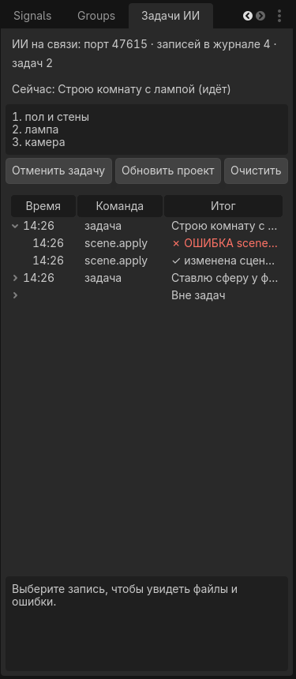

# GodotAI — движок с ИИ внутри

Игровой движок на базе **Godot 4**, построенный вокруг ИИ: человек описывает словами, что хочет, ИИ создаёт и правит игру прямо в редакторе, а движок сам сообщает ИИ, что получилось (сцена, ошибки, снимок экрана).

Главный документ проекта — [docs/PLAN.md](docs/PLAN.md). Его читает любой ИИ и человек перед началом работы. Итог первых двух недель — [docs/REPORT.md](docs/REPORT.md).

## Что где лежит

| Папка | Что внутри |
|---|---|
| `addons/ai_bridge/` | Плагин «Ухо и рука» для Godot (GDScript): принимает команды от ИИ |
| `tools/enginectl/` | Программа `enginectl` на Python: через неё ИИ отправляет команды в редактор |
| `game/` | Игровые модули: персонаж, машина, взаимодействия, сохранения |
| `scenes/` | Сцены демо |
| `docs/` | План, состояние работ, решения, описание команд, реестр ресурсов |

## Что нужно на компьютере

- Godot 4.7.2 (stable)
- Python 3.12
- Git

## Первая проверка связи

1. Открыть проект в Godot (плагин AI Bridge уже включён в `project.godot`).
2. В терминале, из папки проекта: `python tools\enginectl\enginectl.py doctor`
   (если `python` открывает Microsoft Store, использовать `py -3`).
3. В ответе должно быть `"status": "ok"` и «Godot на связи».
4. Открыть в редакторе сцену `scenes/inspect_test.tscn` и выполнить `python tools\enginectl\enginectl.py scene inspect`: в ответе дерево узлов Root → Floor, Cube, Sun, Camera.
5. `python tools\enginectl\enginectl.py scene apply --file tools\enginectl\examples\yard.json --dry-run` покажет план, та же команда без `--dry-run` поставит в сцену поле 30×30 со стенами по периметру, сарай с дверью, свет, персонажа, машину, ключ и кнопку; Ctrl+Z в редакторе убирает всё разом. (Сам двор `scenes/yard.tscn` собран из этого же описания командой `scene build --overwrite`.)
6. `python tools\enginectl\enginectl.py game run --seconds 5` запускает главную сцену (двор) на 5 секунд и возвращает ошибки и вывод игры; `python tools\enginectl\enginectl.py log get` показывает лог последнего запуска.
7. Кнопка **▶ Запустить** (F5) открывает двор с персонажем: W A S D или стрелки — ходьба, Shift — бег, мышь — обзор, пробел — прыжок, Esc отпускает мышь (щелчок по окну захватывает снова). В выводе через секунду строка «Персонаж: на полу=true, …». Двор 30×30 обнесён стенами, уехать за край нельзя; если машина всё же упала ниже двора (на площадке `car_test` края открыты), она сама возвращается на стартовое место, в выводе «Машина упала за край…». Клавиша E действует на ближайший предмет, подсказка внизу говорит, что произойдёт. В углу сарай с запертой дверью: подойти — «Дверь … заперта: нужен Ключ»; жёлтый ключ лежит у машины, E подбирает его («Подобран предмет «Ключ»»), после этого E у двери отпирает и открывает её; внутри сарая кнопка на столбике, E выключает и включает солнце. Во дворе стоит машина: подойти к ней (внизу появится подсказка «E — сесть в машину»), нажать E — камера переходит за машину, управление как на площадке (W, S, A/D, пробел, R), в углу спидометр. E ещё раз — выйти: персонаж появляется у левой двери, у правой, сзади или спереди, там, где есть свободное место и земля; если машина зажата со всех сторон, в выводе «Выйти нельзя: вокруг машины нет свободного места», и персонаж остаётся внутри. Автопроверка без человека: `python tools\enginectl\enginectl.py game run --headless --seconds 8 --test player=goto:3:1.5;-1.2,enter:0.5,wait:2,exit:0.5 --test car=coast:2,gas:1,brake:2` (в выводе «Персонаж сел в машину», «Машина [gas …]», «Персонаж вышел из машины … у левой двери»); фаза `goto:секунды:x;z` ведёт персонажа к точке, `interact` нажимает E. Дверь, ключ и кнопка: `python tools\enginectl\enginectl.py game run --headless --seconds 32 --test "player=goto:4:-4.5;-9,interact:0.3,goto:5:2.5;2,interact:0.3,goto:6:-4.5;-9,interact:0.3,wait:0.8,goto:3:-8;-9.2,goto:2:-9;-10.5,interact:0.3"` (в выводе «заперта», «Подобран предмет «Ключ»», «отперта», «открыта», «Кнопка «SunButton»: солнце выключено»). Возврат машины: `game run --headless --scene res://scenes/car_test.tscn --seconds 10 --test car=gas:3,fall:2,gas:3` (фаза `fall` роняет машину под площадку, в выводе «Машина упала за край… возвращаю на старт», и следующий `gas` снова едет). Esc открывает меню паузы (игра стоит, мышь свободна): «Продолжить», «Сохранить (F5)», «Загрузить (F9)», «Выйти из игры»; F5 и F9 работают и без меню. Сохраняется положение персонажа и машины (и сидит ли персонаж в машине), инвентарь, дверь, кнопка, ключ. Файл `save.json` лежит в `%APPDATA%\Godot\app_userdata\GodotAI\`, прежняя копия рядом как `save.bak.json`; если файл испорчен, игра не падает: в выводе «Загрузка: файл … не годится», и берётся прежняя копия. Проверка: `python tools\enginectl\enginectl.py game run --headless --seconds 26 --test "player=goto:4:-4.5;-9,save:0.3,goto:5:2.5;2,interact:0.3,goto:6:-4.5;-9,interact:0.3,wait:0.8,load:0.5,interact:0.3,save:0.3,corrupt:0.3,load:0.5"` (сохранение у запертой двери → ключ, дверь открыта → загрузка возвращает дверь запертой → второе сохранение → файл испорчен нарочно → загрузка из `save.bak.json`) и меню: `game run --headless --seconds 5 --test player=forward:2.5 --test menu=open:1,save:0.3,load:0.3,close:0.5` (пока меню открыто, персонаж стоит). Все клавиши описаны в одном месте, карте действий (`game/actions.gd`, та же таблица в `project.godot`, в редакторе: Проект → Настройки проекта → Карта действий): скрипты читают действия `move_forward`, `jump`, `interact`, `pause` и т. д., а не клавиши, поэтому клавиатура, геймпад и экранные кнопки работают одинаково. На телефоне (или при запуске с аргументом `--touch`) поверх игры появляется экранное управление (`game/touch_controls.gd`): слева плавающий джойстик (палец где угодно на левой половине), справа кнопки E, Прыжок/Тормоз, R, Бег и пауза, обзор — пальцем по правой половине экрана. Проверка без телефона: `python tools\enginectl\enginectl.py game run --headless --seconds 10 --test "touch=joy:1.5:0.3;-1,button:0.3:interact,joy:1.5:0;-1,button:0.2:pause,button:0.2:pause"` (джойстик ведёт персонажа к машине, E сажает, джойстик ведёт машину, пауза включается и выключается; после каждой фазы строка «Экранное управление [фаза]: персонаж …, машина …»), снимок с панелью: `game screenshot --test touch=show:4`.
8. `python tools\enginectl\enginectl.py game run --scene res://scenes/car_test.tscn --seconds 60` открывает площадку с машиной: клетчатая разметка, коридор из оранжевых столбиков, четыре дома-ориентира по краям, машина — красный грузовичок Kenney (кабина спереди), в углу спидометр. W газ, S тормоз (а после остановки задний ход), A/D руль, пробел тормоз, R поставить на колёса. Камера едет следом. Через 60 секунд окно закроется само. Автозаезд для проверки без человека: добавить `--headless --test car=gas:2,left:1,brake:1`, в выводе будут строки «Машина [gas 2.0 с]: …».
9. `python tools\enginectl\enginectl.py scene build --file tools\enginectl\examples\room.json` создаёт новую сцену `scenes/room.tscn` целиком (пол, четыре стены, лампа, камера, скрипт), сохраняет её и открывает в редакторе. `python tools\enginectl\enginectl.py game run --scene res://scenes/room.tscn --seconds 5` запускает комнату, в выводе «Комната готова: 7 объектов».
10. `python tools\enginectl\enginectl.py game screenshot --scene res://scenes/yard.tscn --after 2` на две секунды открывает окно с игрой, сохраняет кадр в `.godot\ai_bridge\screenshot.png` и закрывает окно; в ответе путь к файлу, размер и вывод игры. ИИ открывает этот PNG, описывает, что видит, и правит сцену. Можно снимать и с самопроверкой: `--test player=goto:3:1.5;-1.2,enter:0.5,wait:9 --test car=coast:2.2,gas:1.5,coast:5 --after 2.5` даёт кадр из-за машины, в которую сел персонаж. `--out` задаёт свой файл, `--size` размер (по умолчанию 1280x720). На Linux без экрана команда сама берёт `xvfb-run` (виртуальный экран, программный OpenGL).
11. `python tools\enginectl\enginectl.py project export --preset Windows --release` собирает игру в один файл `build\windows\GodotAI.exe`, который запускается без редактора и без ИИ (один раз нужны шаблоны экспорта: «Редактор → Управление шаблонами экспорта… → Скачать и установить»). Пресеты Windows, Linux и Android, Android-сборка и проверка на телефоне — в [docs/EXPORT.md](docs/EXPORT.md).

## Как работает «одной фразой»

Человек пишет фразу («сделай комнату: пол, четыре стены, лампа и камера»). ИИ переводит её в JSON-описание сцены (как в `tools/enginectl/examples/room.json`, там же записана и сама фраза) и выполняет одну команду `scene build`. Редактор собирает сцену, сохраняет файл, перечитывает его с диска для проверки и открывает. Если в описании ошибка, файл не создаётся, а ИИ получает список ошибок и исправляет описание. ИИ не пишет файлы `.tscn` руками: это делает редактор, поэтому сцена всегда корректная.

Повторяющиеся вещи описываются один раз как отдельная сцена и вставляются операцией `instance`: машина живёт в `scenes/car.tscn` (из `examples/car.json`), а двор и площадка просто ставят её у себя (`"op": "instance", "scene": "res://scenes/car.tscn"`). Исправил машину — она обновилась везде. Готовые 3D-модели (glTF, `.glb`) вставляются той же операцией: `{"op": "instance", "scene": "res://assets/kenney/racing/vehicle-truck-red.glb", "props": {"scale": [1.4, 1.4, 1.4]}}`; Godot импортирует `.glb` сам. В `assets/kenney/` лежат бесплатные модели Kenney (CC0): грузовички, мотоцикл, домики, деревья, фонтан (см. `assets/kenney/README.md`). Машина теперь — красный грузовичок Kenney: в `car.json` остались только форма столкновений, узел `Model` с моделью и четыре колеса VehicleWheel3D, а `car.gd` при запуске сам ставит колёса на место колёс модели, берёт их радиус и размер кузова (в выводе «Машина: модель «Model», колёс 4, радиус 0.42 м, кузов (2.1, 1.4, 3.92) м»). Другая машина — поменять `scene` у `Model` на `vehicle-truck-yellow.glb`, `-green`, `-purple` или `vehicle-motorcycle.glb` и пересобрать `car.json`. Вокруг двора стоят домики и деревья из тех же наборов; фонтан и два дерева внутри двора твёрдые: у них скрипт `game/prop.gd`, который при запуске строит точные формы столкновений по геометрии модели (в выводе «Предмет «Fountain»: столкновения для 1 мешей»), а у декораций за стенами `solid: false`. Так же сделаны дверь (`examples/door.json` → `scenes/door.tscn`, скрипт `game/door.gd`: открыть/закрыть, может быть заперта и требовать предмет), кнопка (`button.json`, `game/button.gd`: переключает свойство другого узла, например `visible` у солнца) и ключ (`key.json`, `game/item.gd`: предмет, который подбирается в инвентарь). Любой предмет становится «нажимаемым на E», если его скрипт в группе `interactables` и умеет `prompt()` (текст подсказки) и `interact(player)`; персонажу знать про типы не нужно.

Защита ручной работы: если сцена открыта в редакторе с несохранёнными изменениями, `scene build --overwrite` откажется её перезаписывать (а `--force` сначала положит текущее состояние вкладки в `.godot\ai_bridge\backup\`). После правок файлов снаружи (`git pull`, правка скрипта) `python tools\enginectl\enginectl.py project refresh` заставляет редактор перечитать скрипты и открытые сцены с диска.

Самопроверка без терминала: `Godot --headless --path <папка проекта> --editor -- --ai-bridge-selftest`
печатает ответы на верный и неверный токен и строку `AI Bridge selftest: PASS`.

## Панель «Задачи ИИ»

В редакторе справа, рядом с «Инспектором», вкладка **Задачи ИИ** (плагин 0.10.0): что ИИ делает сейчас и его план, список команд с итогом (✓ сделано, ✗ ошибка, ↶ отменено), файлы и ошибки по выбранной записи. Кнопка **Отменить задачу** откатывает последнюю задачу ИИ: изменения сцены через историю (только если сверху лежит именно действие ИИ, ручные правки не трогаются), созданные файлы уезжают в `.godot/ai_bridge/trash`, перезаписанные скрипты получают прежний текст, главная сцена возвращается. **Обновить проект** = `project refresh`, **Очистить** чистит журнал.

ИИ объявляет задачу сам: `enginectl task begin --title "Строю комнату" --plan "пол и стены" --plan "лампа"`, затем обычные команды, затем `enginectl task end --note "комната готова"`. Всё между ними попадает в задачу; `enginectl task undo` делает то же, что кнопка. Журнал лежит в `.godot/ai_bridge/journal.json` (`enginectl journal get`), туда же попадают `game run`, `game screenshot` и `project export`. `enginectl editor screenshot --out файл.png` снимает окно редактора целиком, чтобы ИИ видел то же, что человек (редактор должен быть с окном, не headless).

## Правила

- Секреты (API-ключи, пароли) в репозиторий не кладём: он открытый.
- Готовая игра не должна требовать ИИ для запуска: `project export` собирает её в отдельный файл (см. [docs/EXPORT.md](docs/EXPORT.md)).
